  
  
  
  
  

## About

I build web and mobile applications end to end: React and Next.js on the front, an API and database behind it, deployed and running on AWS.

At **ServiceCo** I build a platform where the website and the mobile app share one codebase. My work there covers the operations dashboards, in-app chat, onboarding, the PostgreSQL schemas and APIs, and an AI assistant that answers questions from the company's own data. Before that, I spent a year building systems for businesses and schools around Batangas: point-of-sale, Philippines-compliant payroll, and clinic records.

## Tech stack

   
   
  

Also: React Native &amp; Expo · AWS ECS, RDS, S3, CDK · pgvector &amp; RAG · AWS Bedrock, OpenAI, Anthropic &amp; Groq APIs · MCP · TanStack Query · Zustand · Zod · shadcn/ui · Framer Motion

## Live work

<table>
  <tr>
    <td width="50%" valign="top">
      
      <h3>Melo · AI resume builder</h3>
      Quick, Guided and AI Chat modes, 20+ templates, an ATS analyzer, a job-description matcher, cover letters and PDF/DOCX export.  
      <code>React 19</code> <code>TypeScript</code> <code>Supabase</code> <code>Groq AI</code>  
      <a href="https://melo-resume.vercel.app"><b>Live site ↗</b></a> · <a href="https://github.com/DevVee/Melo">Code</a>
    </td>
    <td width="50%" valign="top">
      
      <h3>HomeFixer · home services marketplace</h3>
      Connects homeowners with verified pros. Includes provider search, booking, real-time job tracking and GCash/Maya payments.  
      <code>Next.js</code> <code>TypeScript</code> <code>Tailwind CSS</code> <code>Supabase</code>  
      <a href="https://homefixer-web.vercel.app"><b>Live site ↗</b></a> · <a href="https://github.com/DevVee/HomeFixer">Code</a>
    </td>
  </tr>
</table>

## More projects

  
  
  
  

<a href="https://github.com/DevVee?tab=repositories">Browse all repositories →</a>

## Journey

 

